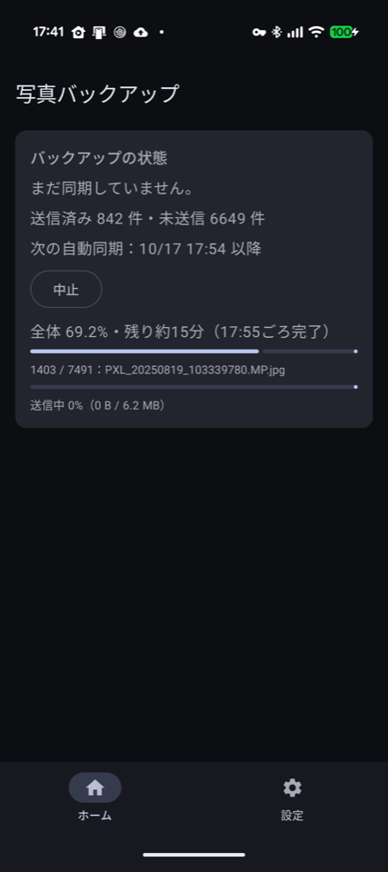
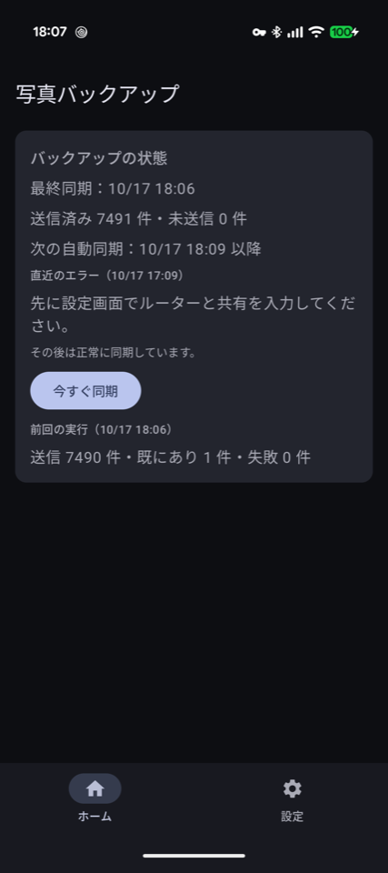
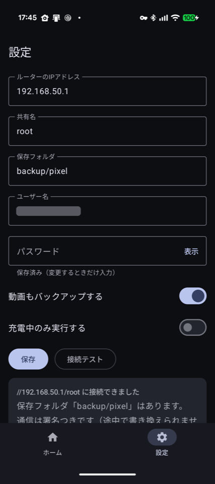
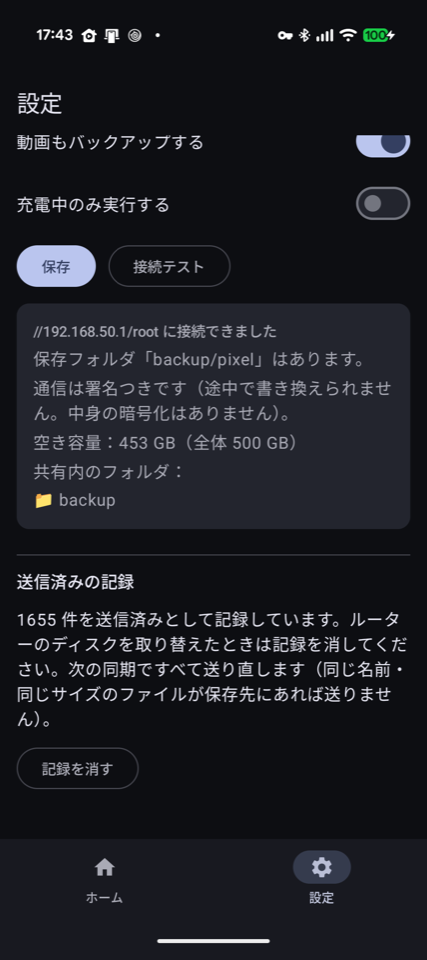
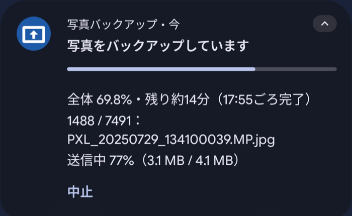
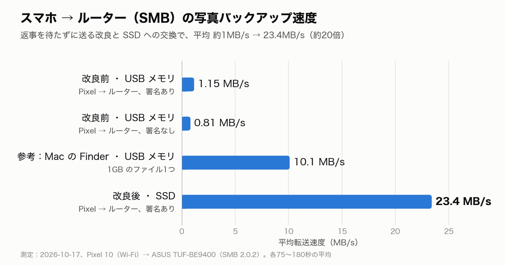

# SMB Photo Backup

Android の写真と動画を、自宅ルーターの USB ストレージ（SMB 共有）へ自動でバックアップするアプリ。

- Kotlin / Jetpack Compose / minSdk 29 / targetSdk 37
- SMB：smbj（SMB2/3）、NTLM の MD4 は BouncyCastle を直接使う。ユーザー名があるときは SMB 署名を必須にする
- 設定：DataStore。SMB のパスワードは Android Keystore の AES-256-GCM 鍵で暗号化して保存

## 画面

| 送信中 | 完了 | 設定 | 接続テストと記録 |
|---|---|---|---|
|  |  |  |  |

送信中は通知にも進み具合と「中止」が出ます。



## 速さ



| 条件 | 平均 |
|---|---|
| 改良前・USB メモリ（署名あり） | 1.15 MB/s |
| 改良前・USB メモリ（署名なし） | 0.81 MB/s |
| 参考：Mac の Finder・USB メモリ（1GB のファイル1つ） | 10.1 MB/s |
| 改良後・USB 接続の SSD（署名あり） | 23.4 MB/s |

Pixel 10（Wi-Fi）から ASUS TUF-BE9400（SMB 2.0.2）へ送って測りました（2026-10-17、各75〜180秒）。遅かった原因は2つです。

- smbj の書き込みは 64KB ごとに返事を待つ。返事を待たずに最大 3MB 先まで送るようにした
- 安い USB メモリへの書き込みで、ルーターがときどき30秒ほど止まる。保存先を USB 接続の SSD に替えた

署名の有無では速さは変わりませんでした。改良後、写真と動画 7491 件・約 66GB の初回のバックアップは約1時間、失敗 0 件で終わりました。

## ビルド

```sh
export JAVA_HOME=/opt/homebrew/opt/openjdk@17/libexec/openjdk.jdk/Contents/Home
./gradlew assembleDebug testDebugUnitTest
adb install -r app/build/outputs/apk/debug/app-debug.apk
```

### リリース版（普段使い）

デバッグ版は adb からアプリの権限で動かせるので、普段使いはリリース版にします。

```sh
./gradlew assembleRelease
adb install -r app/build/outputs/apk/release/app-release.apk
```

- 署名鍵：`~/.android/keystores/photobackup-release.jks`（リポジトリには入れない）
- 鍵のパスワード：macOS のキーチェーン（サービス名 `photobackup-release-keystore`、アカウント `release`）。リリースのタスクを実行したときだけ読む
- デバッグ版とは署名が違うので、上書きでは入れ替えられない。入れ替えるにはデバッグ版をアンインストールする必要があり、設定・パスワード・送信済みの記録が消える

実機での確認手順と、ルーターなしでの試し方は [docs/device-testing.md](docs/device-testing.md)。

## 構成

| パス | 役割 |
|---|---|
| `settings/SettingsRepository.kt` | 設定の読み書き。パスワードだけは別扱いで、平文の設定オブジェクトに載せない |
| `settings/PasswordCipher.kt` | Keystore 鍵での暗号化・復号。鍵が消えていたら null を返し、再入力を促す |
| `smb/SmbGateway.kt` | 1回の処理ごとに接続→認証→共有を開く。サーバー ID が覚えたものと違えば、認証の前に止める |
| `smb/HostProbe.kt` | 445番ポートへの短いタイムアウトでの接続。「家にいるか」の判定にも使う |
| `smb/SmbFailure.kt` | smbj の例外を、利用者が対処できる粒度に分類 |
| `smb/RemotePath.kt` | 共有内のパスは `/` 区切りで持ち、smbj に渡す直前だけ `\` に変える |
| `smb/ShareStat.kt` | 1往復で種類とサイズを取る存在確認。サーバーごとに違う「無い」の返し方をまとめて扱う |
| `media/MediaStoreSource.kt` | 写真・動画の一覧と、GPS を削られていない元データの読み出し（読み取り専用） |
| `media/MediaPermissions.kt` | 全件・限定（Android 14+）・なし の判定と、要求する権限の一覧 |
| `backup/Destination.kt` | 保存先 `<フォルダ>/年/月`（撮影日時が無ければ EXIF の撮影月）、ファイル名の無害化、`名前 (n).拡張子` の連番 |
| `backup/NameResolver.kt` | 同名があればサイズを比べ、同じなら送信済み、違えば次の連番 |
| `backup/Uploader.kt` | 一時ファイルに書く → サーバー上のサイズを確認 → 上書き禁止でリネーム。残った一時ファイルは次の回に消す |
| `backup/UploadDatabase.kt` | 送信済みの記録（Room）。MediaStore の ID・サイズ・更新日時と、共有上のパス。消し損ねた一時ファイルの記録も持つ |
| `backup/SyncPlanner.kt` | 送信済み判定。サイズか更新日時が変わっていれば編集されたとみなして再送 |
| `backup/SyncRunner.kt` | 1回の同期。未送信を新しい順に1本の接続で送り、1件ごとに記録する。同時には1つしか動かない |
| `backup/StallGuard.kt` | データの動きが2分止まったら打ち切る。smbj のタイムアウトが効かない止まり方への備え |
| `sync/SyncScheduler.kt` | 15分ごとの定期ジョブ（従量制でない回線、設定により充電中のみ）と「今すぐ同期」 |
| `sync/SyncWorker.kt` | WorkManager から1回の同期を呼ぶ。送るものがあればフォアグラウンドに切り替えて進捗を通知 |
| `sync/StopSyncReceiver.kt` | 通知の「中止」。いま動いている回だけを止める（15分ごとの予定は残す） |
| `sync/SyncStatusStore.kt` | 最終同期の日時、前回の結果、直近のエラーの保存 |
| `ui/` | ホーム（状態画面と、必要なときだけ出る権限・電池の最適化・通知のカード）と設定画面 |

### 同期中のエラーの扱い

- 接続が切れたら（ルーターの再起動、Wi-Fi 切断など）その回は中断。送れた分は記録済みなので、次の回は続きから
- 接続が生きたままの失敗（その1件が読めない、共有側で名前がぶつかって作れない等）は、その1件だけ失敗として数えて残りを続ける
- 送信済みの記録は1件送るごとに書くので、途中でアプリが終了しても失うのは送信中の1件だけ
- 定期実行は、ルーターに届かない（家にいない）、設定が無い、接続が切れた、のどれでも「成功」で終える。再試行は WorkManager に任せず、次の15分後の回で続きを送る

バックアップと機種変更時の転送はどちらも無効にしています。暗号化したパスワードは
この端末の Keystore 鍵でしか復号できず、移しても使えないためです。
